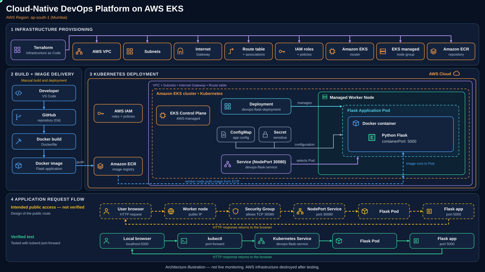

# Cloud-Native DevOps Platform on AWS EKS

This is a learning project where I deployed a small Python Flask application using Docker and Kubernetes on AWS.

## Architecture



## What I did

1. Used Terraform to create AWS networking and EKS infrastructure.
2. Created a Docker image for the Flask application.
3. Stored the Docker image in Amazon ECR.
4. Deployed the application to Amazon EKS using Kubernetes.
5. Used a Kubernetes Deployment, Service, ConfigMap, and Secret.
6. Tested the application using `kubectl port-forward`.

## Tools used

- AWS: VPC, IAM, EKS, ECR
- Terraform
- Docker
- Kubernetes
- Python and Flask
- Git and GitHub

## Application

The Flask app runs on port **5000** and has these endpoints:

- `/` — application status
- `/health` — health check
- `/info` — application information

## Project status

- The app was successfully tested using `kubectl port-forward`.
- Public access through NodePort **30080** was not verified.
- AWS resources were destroyed after testing to avoid ongoing charges.
- Terraform files used for the lab are not currently included in this repository.

## Run the app locally

Open PowerShell in the project folder and run:

```powershell
cd app
python -m venv .venv
.\.venv\Scripts\Activate.ps1
pip install -r requirements.txt
python app.py
```

Then open http://localhost:5000 in your browser.

## Project folders

- `app/` — Flask application
- `docker/` — Dockerfile
- `kubernetes/` — Kubernetes YAML files
- `assets/` — architecture diagram
- `terraform/` — placeholder for Terraform files

## What I learned

I learned how to containerize an application, store an image in ECR, deploy it to EKS with Kubernetes, and test the application.
