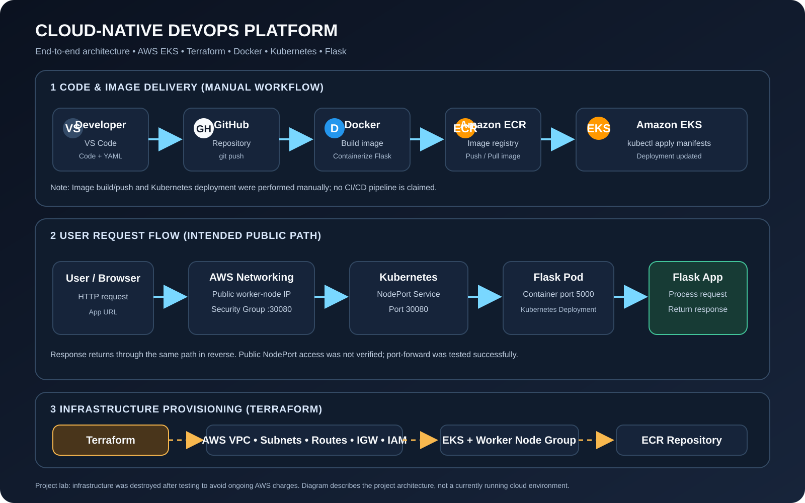
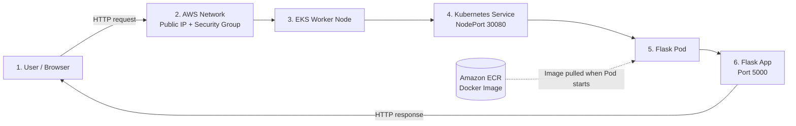
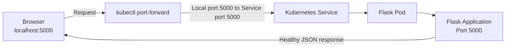
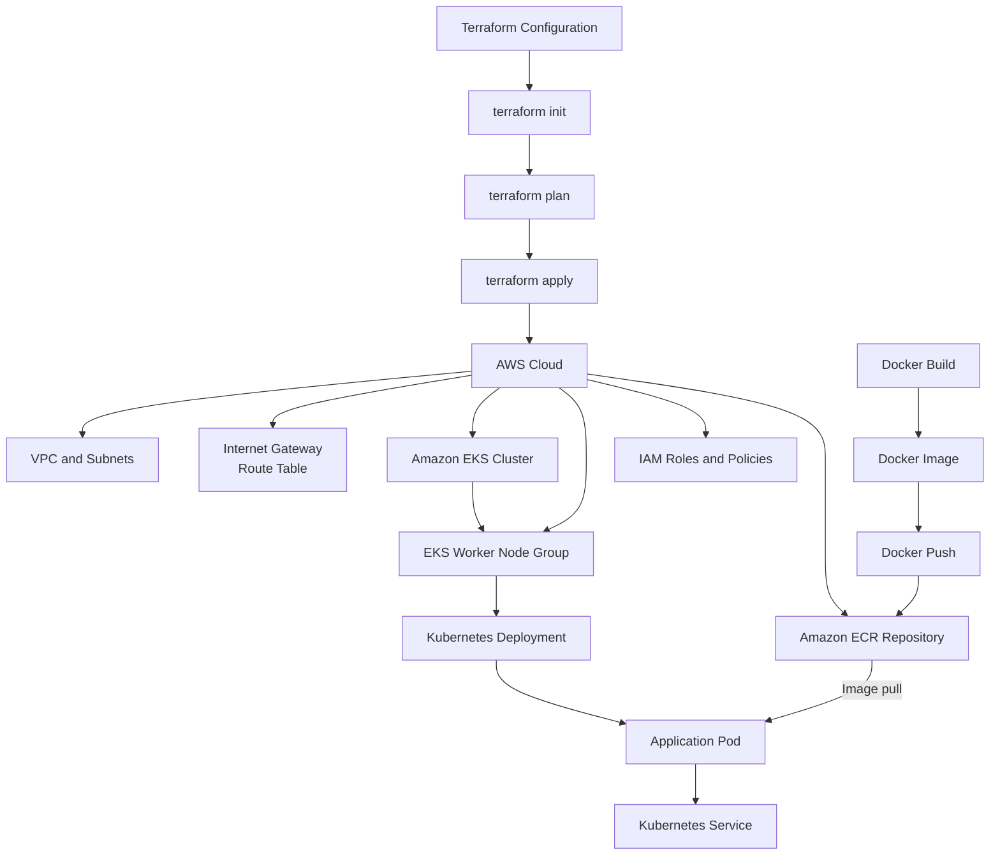

# Cloud-Native DevOps Platform on AWS EKS

A cloud-native DevOps project that deploys a Flask application to Amazon EKS using Docker, Amazon ECR, Kubernetes, and Terraform.

> **Project status:** The Flask application was deployed to EKS and successfully tested through Kubernetes port-forwarding. AWS resources were subsequently destroyed with Terraform to avoid ongoing charges. Public access through NodePort was not fully verified.

## Table of Contents

- [Project Overview](#project-overview)
- [Architecture Diagram](#architecture-diagram)
- [Application Request Flow](#application-request-flow)
- [Infrastructure Provisioning Flow](#infrastructure-provisioning-flow)
- [Technology Stack](#technology-stack)
- [Project Features](#project-features)
- [Application Health Check](#application-health-check)
- [AWS Infrastructure](#aws-infrastructure)
- [Repository Structure](#repository-structure)
- [Prerequisites](#prerequisites)
- [Run Locally with Docker](#run-locally-with-docker)
- [Deploy to AWS EKS](#deploy-to-aws-eks)
- [Kubernetes Resources](#kubernetes-resources)
- [Testing and Validation](#testing-and-validation)
- [Troubleshooting](#troubleshooting)
- [Security Best Practices](#security-best-practices)
- [Terraform Cleanup](#terraform-cleanup)
- [Future Improvements](#future-improvements)
- [What I Learned](#what-i-learned)
- [Author](#author)

---

## Project Overview

This project demonstrates an end-to-end container deployment workflow using AWS cloud services and DevOps tools.

The application is containerized using Docker, stored in Amazon Elastic Container Registry (ECR), and deployed to Amazon Elastic Kubernetes Service (EKS).

Terraform is used to provision and manage the AWS infrastructure as Infrastructure as Code (IaC).

### Project Objectives

- Automate AWS infrastructure provisioning using Terraform.
- Containerize a Flask application using Docker.
- Store and manage Docker images using Amazon ECR.
- Deploy and manage containers using Kubernetes.
- Run Kubernetes workloads on Amazon EKS.
- Configure applications using ConfigMaps and Secrets.
- Expose the application through a Kubernetes Service.
- Validate application health and troubleshoot deployment issues.
- Clean up cloud infrastructure to control costs.

## Architecture Diagram



The image above shows the project in three simple flows:

- **Code and image delivery:** VS Code → GitHub → Docker → Amazon ECR → Amazon EKS
- **User request:** Browser → AWS network / NodePort → Kubernetes Service → Flask Pod → Flask app
- **Infrastructure:** Terraform → AWS networking and IAM → EKS worker nodes and ECR

**Accuracy note:** The application was verified with `kubectl port-forward`. The public NodePort path is the intended design, but public access was not verified. Infrastructure was destroyed after testing. This is an architecture illustration, not live monitoring of a running cluster.


GitHub renders these Mermaid diagrams directly in the README. The arrows show the intended application traffic and deployment paths.

### Simple architecture diagram

Follow the solid arrows to understand how a request reaches the application. The dashed arrow shows where Kubernetes gets the container image.



**In simple words:** Docker image is stored in ECR. EKS runs the image inside a Pod. The Kubernetes Service sends traffic to that Pod, and Flask returns the response.

> **Testing note:** I successfully tested the application using `kubectl port-forward`. Public NodePort access through port `30080` was not confirmed, so the public route above shows the intended setup—not a verified public endpoint.

### Verified testing flow (port-forward)



### Infrastructure provisioning flow



## Application Request Flow

The intended request path is:

1. The user opens the application URL in a browser.
2. The browser sends an HTTP request to the worker node's public IP on NodePort `30080`.
3. The AWS security group must allow inbound TCP traffic on that port.
4. The EKS worker node receives the request.
5. Kubernetes NodePort forwards the request to `devops-flask-service`.
6. The Service selects the application Pod using its label selector.
7. The Pod forwards the request to Flask on port `5000`.
8. Flask processes the request and generates an HTTP response.
9. The response returns through the Pod, Service, worker node, and network to the browser.

The successful test used Kubernetes port-forwarding rather than public NodePort access.

## Technology Stack

| Category | Technology |
|---|---|
| Cloud Provider | Amazon Web Services (AWS) |
| Infrastructure as Code | Terraform |
| Containerization | Docker |
| Container Registry | Amazon ECR |
| Kubernetes Platform | Amazon EKS |
| Container Orchestration | Kubernetes |
| Application | Python Flask |
| Configuration | Kubernetes ConfigMap |
| Sensitive Configuration | Kubernetes Secret |
| Networking | VPC, Subnets, Internet Gateway, Route Table |
| Identity and Access | AWS IAM |
| Source Control | Git and GitHub |

## Project Features

- Infrastructure provisioning using Terraform.
- AWS VPC and subnet configuration.
- EKS cluster and worker node group.
- Docker image build and containerization.
- Private Docker image storage in Amazon ECR.
- Kubernetes Deployment for application management.
- Kubernetes NodePort Service.
- ConfigMap for application configuration.
- Secret resource for sensitive configuration.
- Application health verification.
- Kubernetes troubleshooting and log inspection.
- Terraform destroy for cloud resource cleanup.

## Application Health Check

The Flask application returned this response when tested through port-forwarding:

```json
{
  "message": "Application is running successfully!",
  "project": "Cloud-Native DevOps Platform",
  "status": "healthy"
}
```

This confirmed that the application was running and responding through the Kubernetes Service during the test.

## AWS Infrastructure

Terraform managed the following AWS resources for this lab:

- VPC
- Subnets
- Internet Gateway
- Route table and route-table associations
- Amazon EKS cluster
- EKS managed node group
- IAM roles and policy attachments
- Amazon ECR repository

### AWS Configuration

| Setting | Value |
|---|---|
| AWS Region | `ap-south-1` |
| Region Name | Mumbai |
| EKS Cluster | `devops-eks-cluster` |
| ECR Repository | `devops-flask-app` |
| Kubernetes Service | `devops-flask-service` |
| Application Port | `5000` |
| NodePort | `30080` |
| Worker Instance Type | `t3.small` |

The AWS infrastructure has been destroyed after the deployment lab. These values describe the configuration used during the project.

## Repository Structure

The following is a representative structure. Actual filenames can vary; keep this section aligned with the files in the repository.

```text
Cloud-Native-DevOps-Platform/
├── app/
│   └── app.py
├── Dockerfile
├── k8s/
│   ├── deployment.yaml
│   ├── service.yaml
│   ├── configmap.yaml
│   └── secret.yaml
├── terraform/
│   ├── main.tf
│   ├── variables.tf
│   ├── outputs.tf
│   ├── providers.tf
│   └── other Terraform files
├── .gitignore
└── README.md
```

## Prerequisites

Install the following tools before reproducing the deployment:

- Git
- Docker
- AWS CLI
- Terraform
- kubectl
- An AWS account with permission to create EKS, EC2, VPC, IAM, and ECR resources

Configure AWS CLI:

```bash
aws configure
```

Use AWS region:

```text
ap-south-1
```

Verify the AWS identity and installed tools:

```bash
aws sts get-caller-identity
terraform version
docker --version
kubectl version --client
```

## Run Locally with Docker

Build the Docker image from the project root:

```bash
docker build -t devops-flask-app:latest .
```

Run the container:

```bash
docker run --name devops-flask-container -p 5000:5000 devops-flask-app:latest
```

Open the application at:

```text
http://localhost:5000
```

Check the running container and logs:

```bash
docker ps
docker logs devops-flask-container
```

Stop and remove the container:

```bash
docker stop devops-flask-container
docker rm devops-flask-container
```

If your Dockerfile or Flask source is in a subfolder, use the correct build context.

## Deploy to AWS EKS

> The AWS infrastructure has been destroyed. These steps describe how to reproduce the deployment; they do not mean the cluster is currently running.

### 1. Initialize and validate Terraform

From the Terraform directory:

```bash
cd terraform
terraform init
terraform fmt
terraform validate
terraform plan
```

Review the plan, then create the infrastructure:

```bash
terraform apply
```

Type `yes` only after confirming the resources Terraform will create.

### 2. Build the Docker image

From the application build directory:

```bash
docker build -t devops-flask-app:latest .
```

### 3. Authenticate Docker to Amazon ECR

```bash
aws ecr get-login-password --region ap-south-1 | docker login --username AWS --password-stdin 164253013248.dkr.ecr.ap-south-1.amazonaws.com
```

### 4. Tag and push the image

```bash
docker tag devops-flask-app:latest 164253013248.dkr.ecr.ap-south-1.amazonaws.com/devops-flask-app:latest
docker push 164253013248.dkr.ecr.ap-south-1.amazonaws.com/devops-flask-app:latest
```

For a different AWS account, replace the account ID and ECR URI with your own values.

### 5. Connect kubectl to EKS

```bash
aws eks update-kubeconfig --region ap-south-1 --name devops-eks-cluster
kubectl config current-context
kubectl get nodes -o wide
```

Confirm that kubectl is connected to the AWS EKS cluster, not a local cluster such as Docker Desktop.

### 6. Apply Kubernetes manifests

```bash
kubectl apply -f k8s/configmap.yaml
kubectl apply -f k8s/secret.yaml
kubectl apply -f k8s/deployment.yaml
kubectl apply -f k8s/service.yaml
```

Use the actual manifest paths if your repository structure differs.

### 7. Verify the deployment

```bash
kubectl get deployments
kubectl get pods -o wide
kubectl get services
kubectl logs deployment/devops-flask-deployment
```

Wait until the application Pod is Running and Ready.

### 8. Test using port-forwarding

```bash
kubectl port-forward svc/devops-flask-service 5000:5000
```

Keep the terminal open and visit:

```text
http://localhost:5000
```

Stop port-forwarding with `Ctrl+C`.

### 9. Optional: public NodePort access

The Kubernetes Service uses NodePort `30080`. Public access requires:

- A reachable worker-node public IP or another suitable public endpoint.
- An AWS route and security-group rules that allow the required traffic.
- TCP port `30080` allowed from the intended source.
- A correct Kubernetes Service selector and target port.
- A healthy application Pod.

For a learning environment, restrict inbound access to your own public IP where possible. Avoid opening the NodePort to everyone unless you understand the security implications.

## Kubernetes Resources

### Deployment

The Kubernetes Deployment manages the application Pods and uses the image stored in Amazon ECR:

```text
164253013248.dkr.ecr.ap-south-1.amazonaws.com/devops-flask-app:latest
```

The Flask container listens on port `5000`.

### Service

The Service used in the lab is:

```text
devops-flask-service
```

It exposes the application through NodePort `30080` and forwards traffic to port `5000` in the application Pod.

### ConfigMap

A ConfigMap stores non-sensitive application configuration, such as environment settings.

### Secret

A Kubernetes Secret stores sensitive configuration, such as passwords or tokens. Kubernetes Secrets are not automatically secure merely because they are Secret objects. Use appropriate RBAC, encryption-at-rest configuration, and a managed secret solution for production workloads.

## Testing and Validation

Useful commands for checking the cluster and application:

```bash
kubectl get nodes
kubectl get pods -o wide
kubectl get services
kubectl describe pod <pod-name>
kubectl logs <pod-name>
kubectl get events --sort-by=.metadata.creationTimestamp
```

### Validation performed

- Terraform infrastructure was provisioned.
- The EKS worker node became Ready.
- Docker image was pushed to ECR.
- Kubernetes application Pod reached Running state.
- Kubernetes Service was created.
- Application health response was verified using port-forwarding.
- Terraform destroy was used to clean up the AWS infrastructure.

## Troubleshooting

| Problem | Possible Cause | What to Check |
|---|---|---|
| `ImagePullBackOff` | Image cannot be pulled | ECR URI, image tag, IAM permissions |
| Pod remains `Pending` | Scheduling issue | Node readiness, CPU and memory, Pod events |
| Service has no endpoints | Selector mismatch | Service selector and Pod labels |
| NodePort request times out | Networking or security group | Public IP, route, inbound TCP port `30080` |
| kubectl connects to local cluster | Wrong context | `kubectl config current-context` |
| Application does not respond | Flask app or port issue | Container port, Service targetPort, logs |
| Terraform cannot find VPC | Wrong region or filter | AWS region, account, Terraform variables |

## Security Best Practices

- Never commit AWS access keys or credentials.
- Never commit real passwords, API keys, or tokens.
- Do not commit Terraform state files; they may contain sensitive information.
- Add `.terraform/`, state files, local environment files, and real secret manifests to `.gitignore`.
- Use least-privilege IAM policies.
- Restrict security-group inbound rules to required ports and trusted sources.
- Use unique image tags for repeatable deployments.
- Rotate any credentials that are accidentally exposed.
- Use HTTPS and a managed ingress or load balancer for production applications.

## Terraform Cleanup

AWS resources can continue generating charges while they exist.

Review the destroy plan:

```bash
terraform plan -destroy
```

If the plan contains only resources you intend to remove, run:

```bash
terraform destroy
```

Type `yes` to confirm.

After the destroy completes, check Terraform state:

```bash
terraform state list
```

Also check the AWS Console in the correct region for resources created manually or outside the current Terraform state.

Terraform destroy does not delete local project files, the GitHub repository, or local Docker images and containers.

## Future Improvements

These are planned enhancements, not features claimed as already completed:

- GitHub Actions CI pipeline for testing and Docker image builds.
- Automated image push to Amazon ECR.
- Continuous deployment to Amazon EKS.
- Jenkins pipeline implementation.
- Argo CD GitOps deployment.
- Helm chart for Kubernetes application packaging.
- AWS Load Balancer Controller and Ingress.
- HTTPS using a managed certificate.
- Prometheus and Grafana monitoring.
- Centralized application logging and alerting.
- Kubernetes readiness and liveness probes.
- Horizontal Pod Autoscaler.
- Container image scanning with Trivy.
- Remote Terraform state with locking.
- Separate development, staging, and production environments.

## What I Learned

Through this project, I gained practical experience with:

- AWS cloud infrastructure and networking.
- Terraform Infrastructure as Code.
- Docker image creation and container management.
- Amazon ECR image storage.
- Amazon EKS cluster and worker-node management.
- Kubernetes Deployments, Pods, Services, ConfigMaps, and Secrets.
- AWS IAM roles and permissions.
- Application troubleshooting using Kubernetes logs and commands.
- Testing Kubernetes applications through port-forwarding.
- Cloud resource cleanup and cost awareness.

## Author

**Sameed Khan**

GitHub: [Sameedkhan469](https://github.com/Sameedkhan469)

Project Repository: [Cloud-Native-DevOps-Platform](https://github.com/Sameedkhan469/Cloud-Native-DevOps-Platform)

---

### Project Summary

This project demonstrates provisioning AWS infrastructure with Terraform, containerizing a Flask application using Docker, storing the image in Amazon ECR, and deploying it to Amazon EKS using Kubernetes. The application was successfully validated through port-forwarding, and the Terraform-managed AWS infrastructure was destroyed after testing to control costs.
